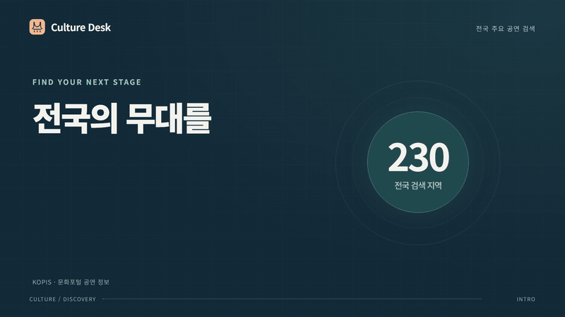
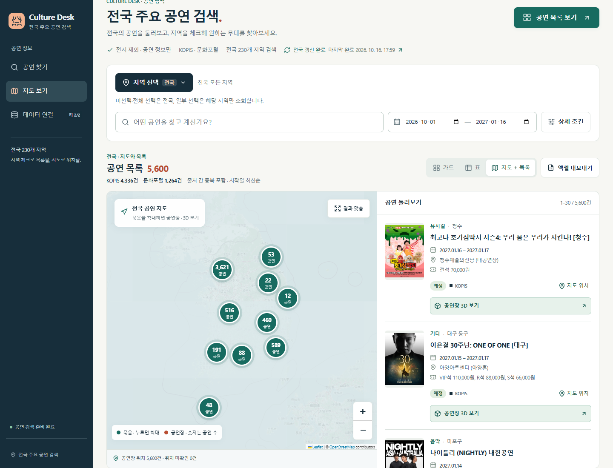

# Culture Desk

[](https://culture-desk.vercel.app/promo/)

**Vercel 서비스 주소: [https://culture-desk.vercel.app](https://culture-desk.vercel.app)**

[홍보 영상 재생](https://culture-desk.vercel.app/promo/) · [MP4 다운로드](https://culture-desk.vercel.app/promo/culture-desk-promo.mp4) · [공연 지도 열기](https://culture-desk.vercel.app/#map)

**전국 주요 공연을 지역별로 검색하고, 지도에서 공연장까지 확인하는 프로그램입니다.**

KOPIS와 문화포털의 공연 정보를 모아 전국 230개 지역을 탐색합니다. 전시는 검색에서 제외하며, 공연 카드·표·지도와 Cesium 공연장 3D 보기를 제공합니다. 웹에서는 별도 설치나 로그인 없이 바로 이용할 수 있습니다.

## 주요 기능

- **전국·지역별 검색** — 지역 복수 체크, 지역명 검색, 시·도별 전체 선택을 지원합니다.
- **상세 조건** — 검색어, 기간, 장르, 공연 상태, 관람료, 관람 연령, 출처로 결과를 좁힙니다.
- **카드·표·지도 전환** — 같은 검색 조건을 유지하며 보기 방식을 바꿉니다. 지도에서는 가까운 공연을 묶어 보여주고 확대하면 위치를 나눠 표시합니다.
- **공연 상세·원문** — 일정, 공연장, 관람료, 출연진 등 제공기관의 상세 정보와 원문을 확인합니다.
- **공연장 3D** — Cesium으로 공연장 위치와 확인된 건물 도형을 살펴봅니다.
- **엑셀 내보내기** — 검색 조건에 맞는 공연 목록과 지역·출처별 조회 근거를 내려받습니다.
- **전국 자동 갱신** — 웹 브라우저와 사용자 PC가 꺼져 있어도 예약 작업이 실행됩니다. 화면에서 마지막 성공과 진행·오류 상태를 확인합니다.

## 사용 방법

사이트를 처음 열면 특정 도시를 미리 체크하지 않고 **전국 공연**을 보여줍니다. 기본 조회 기간은 **이번 달 1일~오늘로부터 3개월 뒤**입니다.

| 지역 체크 상태 | 조회 범위 |
| --- | --- |
| 아무 지역도 체크하지 않음 | 전국 |
| 일부 지역만 체크 | 체크한 지역만 |
| 230개 지역 모두 체크 | 전국 |

1. **지역 선택**에서 원하는 시·군·구를 체크하고 **적용**합니다. 안동·여수·순천·강릉·원주·충주·공주를 포함한 전국 지역을 고를 수 있습니다.
2. 검색어와 기간을 입력하고, 필요하면 **상세 조건**을 엽니다.
3. **카드 / 표 / 지도 + 목록**으로 결과를 확인합니다. 상단 **지도에서 보기**와 메뉴 **지도 보기**에서도 지도를 열 수 있습니다.
4. 공연의 **상세 보기**, **공연장 3D 보기**, **엑셀 내보내기**를 이용합니다.

지역 목록은 KOPIS의 공식 검색 코드 기준입니다. 일부 일반구가 있는 도시는 시 단위로 묶여 있습니다. 전국 조회는 현재 저장된 자료를 대상으로 하며, 갱신 상태는 **데이터 연결 → 전국 자동 갱신**에서 확인합니다.

## 자동 갱신

배포된 웹 서비스는 GitHub Actions가 두 공연 API를 조회하고, Neon에 저장된 운영 데이터에 결과를 반영합니다.

| 항목 | 동작 |
| --- | --- |
| 기본 예약 | 매일 **04:17, 한국 시간** |
| 미완료 작업 복구 예약 | **06:47 · 12:47 · 20:47, 한국 시간** |
| 수집 범위 | 전국 230개 지역 × 2개 출처, 이번 달 1일~오늘로부터 3개월 뒤 |
| 변경 사항 반영 | 매일 목록·상세를 다시 조회하고 출처 ID로 병합, 기존 공연 이력 보존 |
| 중단 후 재개 | 체크포인트를 저장하고 같은 날짜의 미완료 작업을 이어서 처리 |
| 완료 판정 | 지역·출처별 목록과 상세 검증 및 운영 DB 반영까지 성공한 경우 |
| 상태 확인 | 마지막 성공 시각, 수집 범위, 진행 상태, 오류와 지연 안내 |

예약 실행은 서비스 상황에 따라 늦어질 수 있습니다. 제공기관 장애·인증 오류·호출 한도가 발생하면 실패 또는 재시도 상태로 남기며, 마지막 성공 후 36시간 이상 지나면 지연을 표시합니다.

**웹의 전국 자동 갱신은 브라우저를 닫아도 실행됩니다.** 사용자가 웹에서 별도로 시작한 **수동 추가 수집**은 화면이 열려 있는 동안 진행합니다. **로컬 프로그램의 정기 갱신**은 로컬 서버가 실행 중일 때만 동작하며, 로컬과 웹의 데이터는 별도로 저장됩니다.

자세한 복구 방식과 운영 설정은 [자동 갱신 운영 문서](docs/AUTOMATIC_REFRESH.md)를 참고하세요. GitHub 실행 이력은 비공개 저장소 접근 권한이 필요하며, 서비스 화면의 갱신 상태는 로그인 없이 확인할 수 있습니다.

## 지도와 공연장 3D



*2026-10-16 운영 화면. 공연 수와 일정은 갱신 및 검색 조건에 따라 달라집니다.*

2D 지도는 **Leaflet + OpenStreetMap**, 3D 보기는 **CesiumJS + OpenStreetMap 건물 도형**을 사용합니다. 현재 구성에는 지도 API 키나 Cesium ion 키가 필요하지 않습니다. Cesium은 **공연장 3D 보기**를 누를 때 불러옵니다.

- 실제 공연장 좌표를 사용합니다. 좌표가 없는 자료는 위치 미확인으로 표시하며, 도시 중심 좌표가 있는 지역은 중심 집계로 구분합니다.
- 건물 도형과 높이가 확인되면 입체로 표시합니다. 층수로 계산한 높이는 **추정**이라고 표시합니다.
- 실제 외곽은 있지만 높이가 없으면 **높이 가정 모형 · 실측 아님**으로 구분해 입체 미리보기를 제공합니다. 초기 가정값은 12m이며 슬라이더로 조절할 수 있습니다. 원본 높이 자료를 바꾸지는 않습니다.
- 입체 보기·위에서 보기·초기 구도 복원을 지원합니다. 일치하는 도형이 없거나 조회에 실패하면 공연장 위치만 표시합니다.
- 확인된 건물 자료에는 원주 백운아트홀, 안동문화예술의전당, 여수 예울마루가 포함됩니다. 백운아트홀의 6m는 2층 정보를 바탕으로 한 추정 높이입니다.

다른 공연장은 Overpass에서 동적으로 조회합니다. 전국 모든 공연장의 입체 건물이나 실사 모델을 제공하는 것은 아니며, 건물 자료와 제공처 응답 여부에 따라 표시 범위가 달라집니다.

## 로컬 설치 및 실행

**Node.js 24.x(24.14 이상)**와 Git이 필요합니다. 아래 명령은 Windows PowerShell 기준이며, 비공개 저장소에 접근할 수 있는 GitHub 계정으로 실행합니다.

```powershell
git clone https://github.com/koul777/culture-desk.git
cd culture-desk
npm ci
Copy-Item .env.example .env
```

생성된 `.env`에 아래 안내의 API 키를 입력한 뒤 실행합니다.

```powershell
npm run build
npm start
```

브라우저에서 **http://127.0.0.1:4317**을 엽니다. 새 설치에는 운영 사이트의 공연 DB가 포함되지 않습니다. **데이터 연결**에서 지역·기간·출처를 선택하고 **수집 시작**을 눌러 로컬 자료를 가져옵니다.

설치와 빌드를 마친 뒤에는 `Start Culture Desk.vbs`를 더블클릭하면 콘솔 창 없이 실행됩니다. 종료할 때는 화면의 **프로그램 종료** 또는 `Stop Culture Desk.vbs`를 사용합니다. 브라우저 탭만 닫으면 로컬 서버는 계속 실행됩니다.

### API 발급 및 환경 변수

**운영 사이트를 이용하기 위해 API를 신청할 필요는 없습니다.** 별도 로컬 설치나 재배포에는 아래 인증키를 준비합니다. 로컬 수동 수집은 한쪽 키만 있어도 해당 출처를 사용할 수 있으며, 전국 자동 갱신에는 두 API 키가 모두 필요합니다.

| 환경 변수 | 신청·입력 내용 |
| --- | --- |
| `KOPIS_API_KEY` | [KOPIS 공연예술통합전산망 OPEN API](https://kopis.or.kr/por/cs/openapi/openApiInfo.do?menuId=MNU_00074) 인증키 |
| `CULTURE_API_KEY` | [한국문화정보원 한눈에보는문화정보조회서비스](https://www.data.go.kr/data/15138937/openapi.do)의 일반 인증키 **Decoding** |
| `PORT` | 로컬 서버 포트, 기본 `4317` |
| `DATABASE_PATH` | 로컬 SQLite 경로, 기본 `./data/culture.db` |
| `SYNC_INTERVAL_HOURS` | 로컬 정기 갱신 간격, 기본 `24`시간 |
| `REQUEST_INTERVAL_MS` | API 요청 간격, 기본 `350`밀리초 |

```dotenv
KOPIS_API_KEY=
CULTURE_API_KEY=
PORT=4317
DATABASE_PATH=./data/culture.db
SYNC_INTERVAL_HOURS=24
REQUEST_INTERVAL_MS=350
```

키를 변경한 뒤에는 **데이터 연결 → 설정 다시 읽기**를 누르거나 프로그램을 재시작합니다. `.env`와 실제 데이터·로그는 Git에서 제외되며, API 키는 서버에서만 사용합니다. 신청 경로와 활용 목적 예시는 [API 신청 안내](docs/API_APPLICATIONS.md)에 있습니다.

### Vercel 배포 설정

웹 서비스는 Vercel의 정적 프런트엔드와 Node.js API, Neon Postgres 저장소를 사용합니다. 로컬 SQLite와 독립적으로 운영됩니다.

| 설정 위치 | 필요한 값 |
| --- | --- |
| Vercel 서버 환경 변수 | `KOPIS_API_KEY`, `CULTURE_API_KEY`, `DATABASE_URL`, `CRON_SECRET`, `AUTOMATIC_REFRESH_ENABLED=1` |
| GitHub Actions Secrets | `KOPIS_API_KEY`, `CULTURE_API_KEY`, `DATABASE_URL` |

`DATABASE_URL`은 Neon 연결 문자열이고, `CRON_SECRET`은 서버 예약 호출 인증값입니다. 공연 검색 이용자가 입력하는 암호가 아닙니다. 로컬 `.env`를 수정해도 배포 환경 변수는 바뀌지 않습니다. 저장 구조와 운영 절차는 [Vercel 운영 문서](docs/VERCEL.md), 예약 작업 정의는 [워크플로 파일](.github/workflows/refresh-performances.yml)을 참고하세요.

## 개발 및 백업

| 명령 | 용도 |
| --- | --- |
| `npm run dev` | API 서버와 Vite 개발 서버 실행 |
| `npm run typecheck` | TypeScript 검사 |
| `npm test` | 자동 테스트 |
| `npm run build` | 타입 검사 및 배포 빌드 |
| `npm start` | 로컬 서버 실행 |
| `npm run backup` | 로컬 DB를 `data/backups/`에 백업 |
| `npm run restore -- data/backups/백업파일.db` | 백업으로 로컬 DB 복원 |

복원 전에는 로컬 프로그램을 종료합니다. 복원 도구는 DB 무결성과 스키마를 확인하고 기존 DB를 별도 파일로 보존합니다. `.env`는 DB 백업에 포함되지 않습니다.

구성은 **React · TypeScript · Vite / Fastify · SQLite / Vercel · Neon / GitHub Actions**입니다.

```text
web/                       검색·지역 선택·지도·3D 화면
server/                    API 연동, 수집, 검색, 저장, 엑셀
server/cloud/              클라우드 저장 및 자동 갱신 상태
api/                       Vercel API 진입점
shared/                    공통 타입
scripts/                   실행·백업·전국 수집·검증 도구
tests/                     자동 테스트
.github/workflows/         전국 자동 갱신 예약
docs/                      API·운영·구현·검증 문서
```

## 확인된 데이터와 검증

**2026-10-16 검증 시점**, 조회 기간 **2026-10-01~2027-01-16** 기준입니다. 아래 수치는 실시간 집계가 아닌 당시 검증 기록입니다.

| 항목 | 결과 |
| --- | --- |
| 전국 수집 범위 | 230개 지역 × 2개 출처 = **460개 범위 완료** |
| 검색 대상 공연 | **5,600건** — KOPIS 4,336건 + 문화포털 1,264건 |
| 상세 정보·공연장 좌표 | 검색 대상 5,600건 모두 확보 |
| 공연이 조회된 지역 | 200개 지역, 나머지 30개는 해당 기간·출처의 조회 결과 0건 |
| 자동 테스트 | **150개 통과**, 실패 0개 |
| 배포 확인 | 전국·지역 검색, 지도, 공연장 3D, 모바일 화면, 엑셀, 갱신 상태 확인 |

출처가 다른 동일 공연은 각각 표시될 수 있으므로 건수는 고유 공연 수나 인기 순위가 아닙니다. 조회 결과 0건은 해당 지역에 공연이 전혀 없다는 의미가 아닙니다. 분류가 불명확한 자료는 확인 대상으로 분리해 일반 검색에서 제외합니다.

[전국 수집 감사 결과](docs/verification/national-final-audit.json) · [운영 화면 검증](docs/verification/final-production-report.json) · [자동 갱신 상태 검증](docs/verification/automatic-production-status.json) · [테스트 결과](docs/verification/final-release-tests.txt)

## 관련 문서

- [API 연결·신청 안내](docs/API_APPLICATIONS.md)
- [전국 자동 갱신 운영](docs/AUTOMATIC_REFRESH.md)
- [Vercel 배포·저장·운영](docs/VERCEL.md)
- [구현 및 검증 보고서](docs/IMPLEMENTATION_REPORT.md)
- [전국 수집 도구 사용법](scripts/README-national.md)
