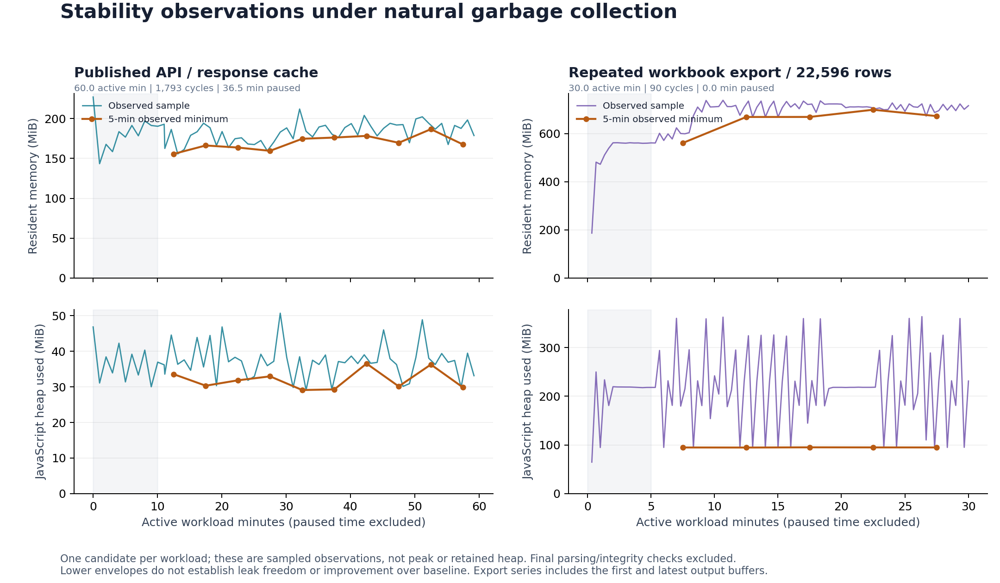

# 반복 조회와 엑셀 생성 안정성

2026년 10월 19일 작업 중 수행한 두 반복 검사가 완료됐다. 지도·검색 검사는 60분의 작업 구간에서 14,345개 요청을 처리했고, 엑셀 검사는 22,596행 파일을 30분 동안 90회 생성했다. 지정된 입력 오류 외의 실패와 데이터 변경은 없었다. 아래 시간은 요청 사이의 대기를 포함한 작업 구간이며 CPU 사용 시간이나 전체 10시간 작업의 완료 시간을 뜻하지 않는다.

| 검사 | 고정한 코드 | 작업 구간 | 전체 경과 | 결과 |
| --- | --- | ---: | ---: | --- |
| 공개 API·응답 캐시 | candidate-wave1 | 60.00분 | 96.79분 | 정상 응답 12,552개, 예상한 HTTP 400 응답 1,793개 |
| 엑셀 연속 생성 | candidate-wave4-cleanup | 30.01분 | 30.30분 | 90회 생성 완료, 첫·마지막 파일의 22,596행 의미 동등성 일치 |

API 검사는 별도 성능 비교를 위해 36.48분 일시 정지했으며, 이 시간은 60분에서 제외했다. 두 검사는 각 고정본의 소스와 데이터 해시를 전후 비교했다. 엑셀 측정 도구의 해시도 같았다. 실행 중 다른 기능 검사가 있었으므로 이 결과의 응답 시간은 속도 개선의 근거로 사용하지 않는다.

## 캐시와 응답 일관성

캐시 관측 최대치는 32개 항목, 3,509,728바이트였다. 완료 시 대기 요청은 0개였고, 동일 조건의 응답 해시와 읽기 전용 데이터베이스가 유지됐다. 요청 합류 3,550회와 캐시 적중 1,869회를 포함한다. 이 장기 검사는 16MiB 용량 한계에 도달하지 않았다.

용량 한계는 별도의 [24개 요청 검사](cache-byte-pressure.md)로 확인했다. 8개 응답의 합계가 18,047,682바이트로 16MiB를 넘자 7개만 보관했다. 보관 바이트와 실제 버퍼 크기가 일치했고, 각 요청 묶음이 끝난 뒤 대기 항목은 0개였다. GET·HEAD와 동시에 도착한 응답에서도 원본 응답 내용이 같았다.

## 메모리 관측

API 검사는 최초 10분, 엑셀 검사는 최초 5분을 제외하고 완전한 5분 구간의 관측 최솟값을 계산했다. API의 힙 최솟값은 29.11–36.56MiB였으며, 앞·뒤 세 구간의 중앙값 차이는 −1.71MiB였다. 엑셀의 힙 최솟값은 94.71–95.15MiB였고, 앞·뒤 두 구간의 중앙값 차이는 +0.16MiB였다.

엑셀의 RSS 최솟값은 같은 구간에서 560.83–698.93MiB였다. 힙 최솟값이 비슷하더라도 RSS가 늘어난 원인을 이 표본만으로 분리할 수는 없다. 이 그래프는 강제 가비지 컬렉션 없이 얻은 표본으로, 최대 메모리·실제 보유 힙·모든 경로의 누수 유무를 확정하지 않는다. 시작 기준 코드와의 메모리 개선 비교는 별도의 [5쌍 비교](export-memory-paired-22596.json)에 있다.

엑셀 검사에는 검증용 첫 파일과 최신 파일 버퍼 약 3.94MiB가 포함된다. 중간 88개 파일은 ZIP 표식과 파일 크기 범위, 읽기 전용 상태를 검사했다. 전체 셀·서식의 의미 동등성 검사는 첫·마지막 두 파일에 수행했다. 종료 후 파일 파싱과 DB 무결성 확인에서 생긴 메모리는 그래프에 포함하지 않았다.

## 재현 자료

- [API 원본 결과](soak-wave1-60min.json) · [원본 시계열](soak-wave1-60min.ndjson) · [구간 분석](soak-wave1-analysis.json)
- [엑셀 원본 결과](export-soak-wave4-30min.json) · [원본 시계열](export-soak-wave4-30min.ndjson)
- [그림 집계와 입력 SHA-256](stability-memory-01.json) · [벡터 그림](stability-memory-01.svg)
- [그림 생성 코드](../../../scripts/performance/soak-plots.py)
